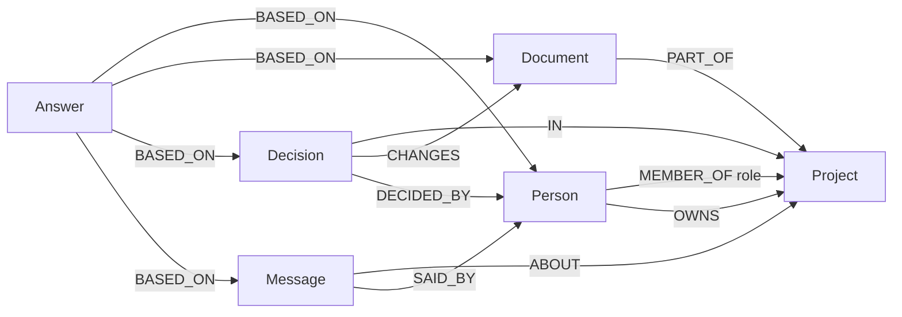

# Lantern

Lantern is a shared workspace for a repository your team already has on GitHub. Sign in, clone the repo onto the server, and edit it together with live cursors and chat. Under that, a FalkorDB graph keeps the people, files, commits, and chat. Ask a question in the workspace brain and the graph chooses what to look at, then returns an answer you can follow back to the person, file, commit, or message it came from.

PostgreSQL stores accounts, workspaces, and invites. FalkorDB is the graph the brain reads and writes.

## Setup

`npm run dev` starts the React app only. Open `http://localhost:5173`. Sign-in, the editor, and the brain stay in the API, which this command does not start.

1. Copy the environment file:

   ```bash
   cp .env.example .env
   ```

2. Fill these values in `.env`.

   | Name                        | Value                                                                                                    |
   | --------------------------- | -------------------------------------------------------------------------------------------------------- |
   | `POSTGRES_PASSWORD`         | The password of your local PostgreSQL user. Use the same password inside `DATABASE_URL`.                 |
   | `GITHUB_CLIENT_ID`          | From a GitHub OAuth app.                                                                                 |
   | `GITHUB_CLIENT_SECRET`      | Secret from that same app.                                                                               |
   | `GITHUB_OAUTH_REDIRECT_URL` | `http://localhost:4000/auth/github/callback`                                                             |
   | `JWT_SECRET`                | `openssl rand -base64 32`                                                                                |
   | `TOKEN_ENCRYPTION_KEY`      | Run that command again. It must differ from `JWT_SECRET`. Both values are Base64 and decode to 32 bytes. |

   `DATABASE_URL` stays on `localhost:5432`. Create the `together` database if it does not exist yet. `WORKSPACE_ROOT=../data/workspaces` stores cloned repos in this project.

3. Create a GitHub OAuth app with scopes `read:user`, `user:email`, and `repo`.

   | GitHub setting             | Value                                        |
   | -------------------------- | -------------------------------------------- |
   | Homepage URL               | `http://localhost:5173`                      |
   | Authorization callback URL | `http://localhost:4000/auth/github/callback` |

   `CORS_ORIGIN` in `.env` stays `http://localhost:5173`. The callback URL in GitHub and `GITHUB_OAUTH_REDIRECT_URL` must match exactly.

4. Install dependencies and start the React app:

   ```bash
   npm install
   npm run dev
   ```

   Open `http://localhost:5173`. Stop it with Ctrl+C.

Do not commit `.env`. It holds the database password, the GitHub client secret, and the two encryption keys.

For a public HTTPS tunnel, set the GitHub homepage, the callback URL, `CORS_ORIGIN`, and `GITHUB_OAUTH_REDIRECT_URL` to that exact origin, and add the tunnel hostname to `VITE_ALLOWED_HOSTS`. Restart `npm run dev` after changing those values, then sign in again.

## Use the workspace

Sign in with GitHub, create a workspace from a repository, and invite a teammate. Everyone in the workspace can open files, edit them at the same time, and use chat.

Open the brain from the header and ask in plain language, or choose Dictate and speak the question. Useful starts are “Who owns this workspace?”, “Where is the README?”, and “What did the team say in chat?”. A follow-up such as “What did we just find?” walks the previous answer. File sources open in the editor. The gold trace lists which agent ran and which relationship allowed it.

Hear it sends that answer to Fish Audio and plays the audio. A dictated question is spoken back on its own. Set `FISH_AUDIO_API_KEY` for this. `FISH_AUDIO_VOICE_ID` is a voice id from the Fish library, and the Voice field in the panel overrides it for one answer. The default model is `s2.1-pro-free`. Without a key, the brain still answers on screen and voice returns a clear error.

Source Control can show status, commit every change in the server workspace, pull, and, for the owner, push the current branch. The GitHub token stays encrypted on the server. If a push says authentication failed, sign out and sign in again.

## Graph data model

Each workspace has one FalkorDB graph. The name is `together_` plus the workspace id with hyphens removed. A question rebuilds that graph when it is older than about 20 seconds. Answers are copied out before the rebuild and written back afterward, so a follow-up can still see them.

The brain reads up to 60 text files, skipping `node_modules`, `dist`, `build`, `.next`, `coverage`, `vendor`, and `.git`. Each file excerpt is at most 500 characters. Decisions are the latest 20 commits. Chat is the latest 100 messages.

### Nodes

| Label      | Properties                                          | Meaning                                                       |
| ---------- | --------------------------------------------------- | ------------------------------------------------------------- |
| `Project`  | `id`, `name`, `repo`, `builtAt`                     | The workspace and the GitHub repo it was cloned from.         |
| `Person`   | `id`, `username`                                    | A member of the workspace.                                    |
| `Document` | `path`, `name`, `excerpt`                           | A text file in the workspace.                                 |
| `Decision` | `sha`, `message`, `authorName`                      | One commit.                                                   |
| `Message`  | `id`, `content`, `username`, `channel`, `createdAt` | One chat message. `channel` is `chat`.                        |
| `Answer`   | `id`, `question`, `text`, `createdAt`               | A previous brain answer, kept so a later question can use it. |

### Relationships



`MEMBER_OF` carries the membership role, `OWNER` or `COLLABORATOR`. `OWNS` is added only for owners. `DECIDED_BY` is added when the commit author name and a member username contain each other. `BASED_ON` points at the exact person, file, commit, or message the answer used.

### How a question uses the graph

The context agent searches those nodes for the words in the question, and it also matches relationship names. “Owns” can select `OWNS` without a keyword list in the server. The relationships around the matches choose the agents:

- `OWNS` or `MEMBER_OF` runs the people agent.
- `CHANGES` or `DECIDED_BY` runs the decision agent.
- `SAID_BY` runs the chat agent.
- `PART_OF` runs the file agent only when a document was found.

If nothing matches, the context agent opens the latest `Answer` and follows `BASED_ON`. If there is no earlier answer, it starts from `Project`, whose owner and member links are enough to run the people agent.

The action agent writes a new `Answer` and a `BASED_ON` edge for each source it linked. The text in the panel is read back from those edges.

The graph does not contain tickets or a separate “who knows what” record. A decision is a commit. Chat stays chat unless a question follows an answer that already linked those messages.

## Checks

From the repository root, with dependencies installed:

```bash
npm run lint
npm run build
npm run format:check
```

## Troubleshooting

- **GitHub sends you back with an error.** The callback URL on the OAuth app must be exactly `GITHUB_OAUTH_REDIRECT_URL`.
- **The landing page says the API is offline.** The React app is running and the API is not. `npm run dev` does not start the API.
- **The brain says FalkorDB is not running.** FalkorDB has to be listening on `localhost:6379`. There is no keyword fallback when the graph is down.
- **A public tunnel is blocked.** Add only that hostname to `VITE_ALLOWED_HOSTS`, then restart `npm run dev`.
- **Push says authentication failed.** Sign out and sign in with GitHub again. Do not paste a token into the app.
